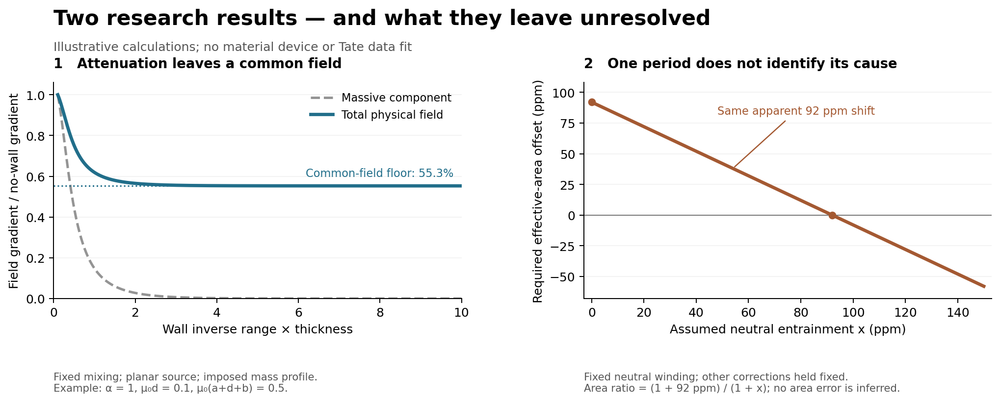

# Parallel Research Review — Two-Metric Gate and Tate Ring

**Date:** 2026-09-04

The housekeeping and first bounded research pass are complete. The two calculations were developed in parallel, checked against primary sources, and reviewed by a separate internal physics reviewer. Their results sharpen the next decision; neither establishes a new gravitational effect.

## Decisions

| Track | Result accepted within stated assumptions | Remaining scientific requirement |
|---|---|---|
| [Two-metric Gate 0](Tensor-Mode-Transformer-Gate-0-2026.md) | A scalar prefactor multiplying the chosen interaction potential cannot rotate the fixed mass eigenvectors. Its static slab can filter a massive contribution, while the common field passes. Source and gate receive opposite incremental forces. | A supported background or kinetic-sector completion that changes the common physical response, with full constraints, stability, material coupling, and source stress. |
| [Tate finite ring](Tate-Finite-Ring-and-Measurement-Audit-2026.md) | Ring-period and bulk-field coefficients differ in the general two-component model. The neutral `1+x` result survives on a fixed-neutral-winding branch. Finite pickup geometry and surface response must be included in interpretation. | Primary apparatus/reduction records and raw calibration covariance for an empirical re-fit; independent material and winding evidence for a neutral-phase interpretation. |

The current architecture remains an externally supported universal worldtube. The scalar-prefactor implementation has failed as a common-mode converter; the broader architecture has not acquired a material realization. The Tate work remains a matter-response companion.



*Left: a synthetic fixed-mixing slab example. The plateau is parameter-dependent, not a universal 55% gravity bound. Right: an illustrative degeneracy of a 92 ppm coefficient shift; no actual area error or entrainment value is inferred. [Figure and independent-check source](../02_Gravitation-Theory/Parallel-Review-2026-09-04/independent_checks_and_figure.py).*

## 1. What the two-metric calculation established

For fixed kinetic coefficients and a fixed proportional reference background, the linear combinations are

\[
H=\frac{h+\alpha^2 l}{1+\alpha^2},\qquad D=h-l,
\]

with the matter metric `h=H+[alpha²/(1+alpha²)]D`. The scalar prefactor changes the mass of `D`; it does not change these eigenvectors. Retaining the full static Fierz–Pauli constraints gives a legitimate planar lapse boundary problem rather than a transverse-wave analogy.

For the stated positive-mass barrier and ordinary external source,

\[
T_{\rm physical}=\frac{1+rT_{\rm massive}}{1+r},
\qquad T_{\rm physical}\ge\frac1{1+r}.
\]

Here `r` is the incoming massive/common acceleration ratio. A source with little incoming massive component cannot have much of its total field changed by this gate. In the synthetic reference case, the massive contribution falls to `0.00091965` of its original value, while the complete acceleration remains at `0.55329`. These are illustrative parameter choices, not an experimentally allowed or realized device.

The source/gate interaction force closes with equal opposite signs. This is a reduced static reaction calculation; it does not supply the unknown material stress, switching energy, full nonlinear interface, spherical worldtube, or whole-craft support solution. The report explicitly checks the finite-density source-contact weak-field condition as well as exterior metric smallness. It does not use a planar calculation to claim Vainshtein or general interface stability.

**Next decision:** any proposed continuation must exhibit the term that changes the common physical lapse. A new material name, a shorter penetration depth, or periodic modulation of the same fixed-basis prefactor does not supply that term. A dynamically solved background/kinetic completion is a possible research direction; its viability remains open.

## 2. What the Tate calculation established

The circulation source depends on the winding vector as well as the same stiffness matrix that generates the bulk field. For one electronic winding increment and a fixed second winding,

\[
\frac{m_{\rm spacing}}{m_s}
=\frac{1+x+y(x+r)}{1+xy}.
\]

The bulk-field denominator is instead `1+2xy+ry²`. This corrects the mapping of the general July kernel onto a ring measurement without invalidating the original bulk equation. In the neutral limit `y=0`, the `1+x` specialization remains, but only if the neutral winding stays fixed. Relaxation or allowed co-winding can remove that shift; positive stiffness does not establish the necessary preparation or lifetime.

The finite-width electromagnetic calculation derives a pickup-weighted effective area. A zero measured pickup can coexist with nonzero local currents. Numerical examples demonstrate this dependence, but use explicitly synthetic geometry. Their mesh convergence is not a bound on physical-model error and is not a calculation of Tate's actual correction.

The covariance model shows that repeated periods in one unchanged geometry identify one combination of intrinsic response, area, and surface effects. More repetitions alone cannot determine which contributes. Two independently calibrated pickup geometries, same-film penetration data, controlled surface/charge state, and winding-history measurements would provide more discriminating information.

The [source/input manifest](../02_Gravitation-Theory/Tate-Ring-Analysis/sources/SOURCE-AND-INPUT-MANIFEST-2026-09-04.md) verifies the published mass ratio and historical apparatus class. It does not contain the full T90 paper, raw flux sweeps, exact film dimensions, or the calibration covariance. The reported 21 ppm is retained as the published accuracy/uncertainty description, without inventing a new statistical interpretation or significance. No empirical re-fit or anomaly explanation is claimed.

## Internal review and verification

The separate reviewer independently checked the fixed-eigenvector argument, variable-mass constraints, static source normalization, recoil signs, finite-ring winding algebra, neutral preparation conditions, and surface/covariance bookkeeping. The review found no remaining substantive algebra error within the stated models. Exactness fixes included keeping the baseline mass ratio explicit in the Tate differential and distinguishing a log-shift Jacobian from the shift Jacobian. The source-contact and physical-model-accuracy limitations are visible beside the relevant calculations.

| Verification package | Checks and outcome |
|---|---|
| [Tensor calculation](../02_Gravitation-Theory/Tensor-Mode-Transformer/README.md) | No-wall/zero-thickness/overlap limits; component constraints; independent BVP versus analytic slab; smooth-to-step behavior; finite-density source plus smooth wall; opposite source/gate forces. All assertions pass. |
| [Tate calculation](../02_Gravitation-Theory/Tate-Ring-Analysis/README.md) | Eight check groups, including 200 positive-stiffness charged examples, single-phase and neutral winding limits, pickup roots, annulus refinement, GLS covariance, and parameter rank. All assertions pass. |
| [Additional coordinating checks](../02_Gravitation-Theory/Parallel-Review-2026-09-04/independent_checks.json) | Five separately implemented Robin boundary problems agree with the slab formula to at worst approximately `1.1e-9` relative; 1,000 seeded positive-definite kernels verify the ring-period identity. |

These are internal analytical and computational checks. They are not external peer review, experimental replication, or proof of a microscopic implementation.

Run from the project root using Python with NumPy and SciPy; the figure also uses Matplotlib:

```powershell
python '02_Gravitation-Theory/Tensor-Mode-Transformer/tensor_mode_transformer.py'
python '02_Gravitation-Theory/Tate-Ring-Analysis/tate_ring_analysis.py'
python '02_Gravitation-Theory/Parallel-Review-2026-09-04/independent_checks_and_figure.py'
```

The verified environment used Python 3.14, NumPy 2.4.3, SciPy 1.17.1, and Matplotlib 3.10.8. Scripts write only their documented generated outputs. No global runtime or dependency changes were made.

## Knowledgebase changes

- Reconciled overview, current execution, thread pages, and current-path routing; marked old scalar/comprehensive prompts and July rankings as historical.
- Recorded the two new results in the active handoff, constraints, mechanism map, original bulk derivation, and July idea portfolio.
- Corrected the old absolute claim that Hoang had no corrigendum: the verified 2020 correction changes an affiliation only, leaving the measurement audit open.
- Narrowed the broad Ross free-fall wording in the GEM topic to its tested passive solar-direction response.
- Retained existing source-ingestion edits. Downloaded third-party PDFs/text remain local; original reports, scripts, selected provenance summaries, numerical outputs, and the explanatory figure are eligible for version control.

For the next session, use [Next-Conversation Brief](../00_Knowledgebase/NEXT-CONVERSATION-BRIEF.md). It distinguishes completed calculations from the remaining model and empirical dependencies.
